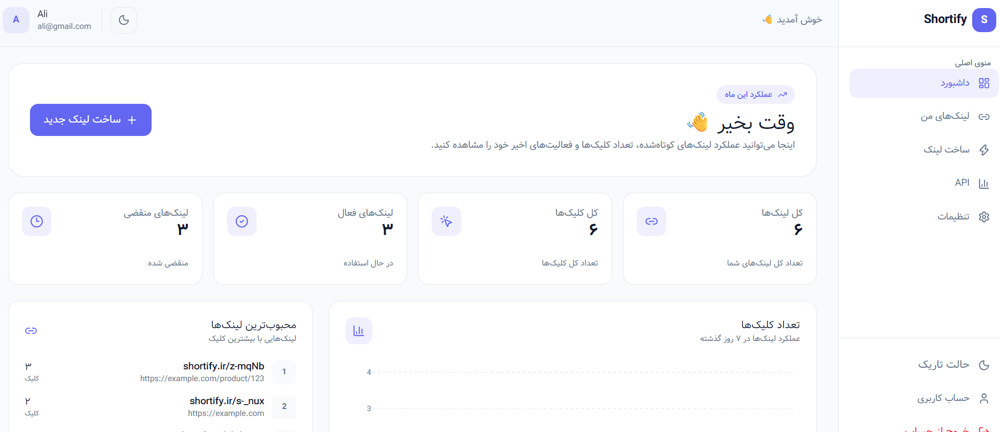
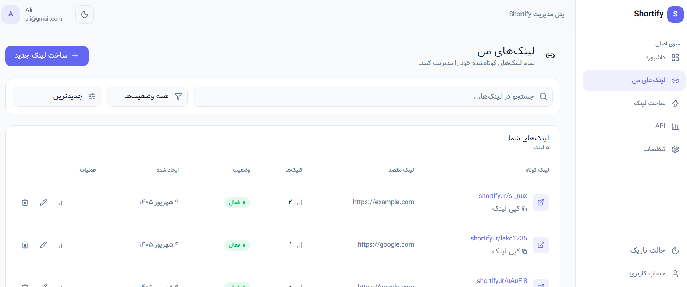

# Shortify — URL Shortener Frontend

Shortify is a modern, responsive URL-shortening dashboard built with React and TypeScript. It provides a Persian (RTL) interface for managing short links, viewing link analytics, and configuring account preferences.

> **Project status:** Frontend UI implemented and tested. Some actions currently use mock data and are intended to be connected to the Shortify FastAPI backend.

## Preview





## Features

- **Landing page** introducing the Shortify service
- **Authentication UI** for sign up, sign in, and password recovery
- **Dashboard overview** with summary cards and click analytics chart
- **Link management** with search, status filtering, sorting, and pagination
- **Create short links** with form validation, optional settings, and URL preview
- **Link details** and analytics pages
- **Edit link** interface
- **API page** for API-key and endpoint UI
- **Account settings** for profile details, password, and appearance
- **Light and dark themes**
- **Responsive layouts** for mobile, tablet, and desktop
- **Persian RTL layout** with a Persian-friendly font

## Tech Stack

- React
- TypeScript
- Vite
- Tailwind CSS
- React Router
- Lucide React
- Recharts (charts)

## Getting Started

### Prerequisites

- Node.js (LTS recommended)
- npm

### Install dependencies

```bash
npm install
```

### Run the development server

```bash
npm run dev
```

Vite will print the local development URL in the terminal (commonly `http://localhost:5173`).

### Build for production

```bash
npm run build
```

### Preview the production build

```bash
npm run preview
```

## Project Structure

The main source code is organized under `src/`. Exact filenames may evolve as the project develops.

```text
src/
├── components/
│   ├── dashboard/
│   │   ├── create-link/
│   │   └── ...
│   ├── ...
├── contexts/
├── layouts/
├── pages/
│   ├── dashboard/
│   └── ...
├── utils/
└── ...
```

## Backend Integration

The frontend is being prepared for integration with the separate **Shortify Backend**, built with FastAPI and PostgreSQL.

The intended integration includes:

- User registration and login
- Authenticated profile and settings operations
- Creating, listing, editing, and deleting links
- Redirect handling for short links
- Link click analytics
- API-key management

Until the backend integration is complete, treat mock interactions and displayed sample data as UI demonstrations rather than persisted production data.

## Development Notes

- Keep the UI consistent with the existing theme variables and shared components.
- Test responsive behavior at mobile, tablet, and desktop widths.
- Run `npm run build` before committing significant changes.
- Do not commit secrets or local environment files. If environment variables are introduced, document the required names in an `.env.example` file and keep real `.env` files out of Git.

## Roadmap

- [ ] Connect authentication screens to the FastAPI backend
- [ ] Load dashboard and link data from the API
- [ ] Implement real link creation and editing
- [ ] Connect analytics to click data
- [ ] Connect API-key management
- [ ] Add end-to-end testing
- [ ] Deploy the frontend

## License

No license has been specified yet. Unless a license is added to this repository, all rights remain with the copyright holder and reuse is not automatically permitted.
